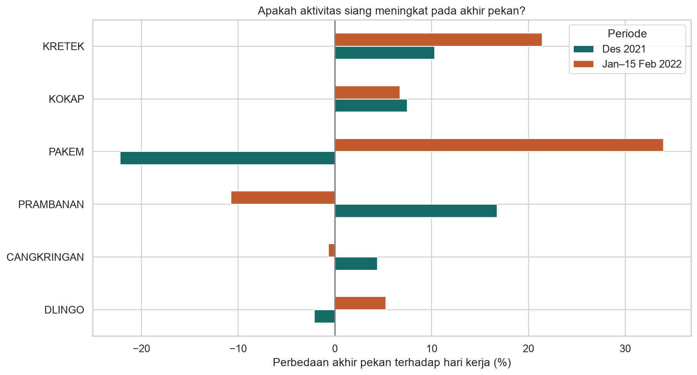
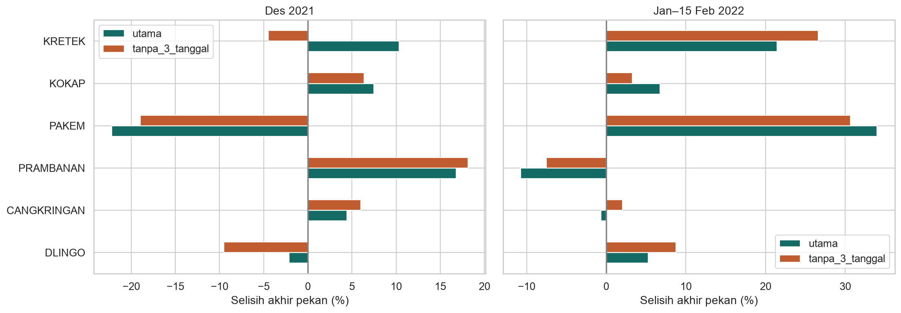

# Kawasan Wisata Jogja Lebih Aktif Saat Akhir Pekan?

Proyek **Human Mobility** yang membandingkan aktivitas siang hari kerja dan akhir pekan pada kapanewon di DIY yang memiliki destinasi wisata terdokumentasi. Analisis memakai data **1 Desember 2021–15 Februari 2022**.

[Buka di Google Colab](https://colab.research.google.com/drive/1DvzX-nuuoy03t1u9p99IQd4ZRJotZYlm) · [Lihat gambar hasil](gambar/) · [Unduh PowerPoint](presentasi/Kawasan%20Wisata%20Jogja%20Lebih%20Aktif%20Saat%20Akhir%20Pekan.pptx)

## Anggota kelompok

| Nama | NIM |
|---|---|
| Muhammad Khoirunas | 24/533373/TK/59083 |
| Aulia Nur Fajri Tri Anggoro | 24/535054/TK/59327 |
| Muhammad Farrel Alghazy | 24/540589/TK/60022 |
| Wangsit Nursyahada | 24/545092/TK/60594 |
| Naufal Dzaky | 24/543697/TK/60431 |

## Pertanyaan penelitian

Apakah rata-rata kehadiran perangkat pada jam siang lebih tinggi saat Sabtu–Minggu dibanding Senin–Jumat di wilayah studi kasus?

Tujuh wilayah dipilih berdasarkan referensi destinasi yang terbit sebelum periode penelitian. Ini studi kasus, bukan inventaris lengkap destinasi DIY. Wilayah lain tidak diasumsikan sebagai wilayah tanpa wisata.

## Data

- **JogjaPulse / UGM:** jumlah perangkat teramati per kapanewon dan jam. Sumber asli: [Zenodo](https://zenodo.org/records/23157460); salinan yang dibaca notebook: [Sheets mobilitas](https://docs.google.com/spreadsheets/d/1Jjj2X3sl5RBoUiKUOKsP9UmOueOcdFjvJ8weeVJ_wQA/edit).
- **Visiting Jogja / Dinas Pariwisata DIY:** dokumentasi destinasi, alamat wilayah, serta tanggal publikasi. Tabel kurasi beserta URL bukti: [Destinasi Terverifikasi](https://docs.google.com/spreadsheets/d/1_gXsB8Mg7vkoK0HiGuug1Ei0TJu75jdrVbL6maZkzm4/edit#gid=202211).
- **OpenStreetMap / Nominatim:** titik representatif administratif untuk orientasi peta. Koordinat merupakan referensi saat pengambilan, bukan titik objek wisata atau batas historis. Atribusi [© OpenStreetMap contributors, ODbL](https://www.openstreetmap.org/copyright).

## Metode singkat

1. Pisahkan Desember dari Januari–15 Februari karena perubahan sampel pada 1 Januari. Periode diakhiri sebelum perubahan sampel 16 Februari.
2. Pilih wilayah dengan cakupan minimal **90% pada masing-masing periode**.
3. Gunakan hari dengan seluruh **10 jam, pukul 08.00–17.00**, tersedia. Setiap wilayah memerlukan minimal empat hari akhir pekan dan sepuluh hari kerja lengkap pada kedua periode.
4. Hitung aktivitas siang sebagai **rata-rata hitungan perangkat per jam**. Data hilang tidak diisi nol; hitungan tidak dijumlahkan menjadi perangkat unik harian.
5. Bandingkan rerata aktivitas akhir pekan dengan hari kerja pada wilayah dan periode yang sama:

```text
Selisih akhir pekan (%) = 100 × (rerata akhir pekan / rerata hari kerja − 1)
```

Sebagai pemeriksaan sensitivitas, perhitungan diulang tanpa 25 Desember 2021, 1 Januari 2022, dan 1 Februari 2022. Pemeriksaan ini tidak mengendalikan seluruh kalender libur atau pandemi.

## Hasil utama

Dari tujuh wilayah kasus, **enam memenuhi syarat**. Tanjungsari dikeluarkan karena cakupan kurang lengkap.

| Wilayah | Desember 2021 | Januari–15 Februari 2022 |
|---|---:|---:|
| Cangkringan | +4,41% | −0,68% |
| Dlingo | −2,14% | +5,27% |
| Kokap | +7,49% | +6,76% |
| Kretek | +10,33% | +21,43% |
| Pakem | −22,22% | +33,98% |
| Prambanan | +16,79% | −10,73% |



**Kokap dan Kretek positif pada dua periode dalam analisis utama.** Empat wilayah lain berubah arah. Namun, setelah tiga tanggal khusus dikeluarkan, hasil Kretek pada Desember berubah menjadi **−4,47%**, sedangkan Kokap tetap positif pada kedua periode. Dengan demikian, hasil tidak mendukung klaim bahwa semua kawasan wisata selalu lebih aktif saat akhir pekan.



Hasil bersifat deskriptif, tanpa klaim signifikansi statistik atau sebab-akibat. Kehadiran perangkat di kapanewon mencakup penduduk dan aktivitas lain; **data tidak menghitung pengunjung objek wisata**. Sampel aplikasi, perubahan sampel, periode pandemi, dan hari tidak lengkap membatasi interpretasi.

## Menjalankan notebook

1. Buka [Google Colab](https://colab.research.google.com/drive/1DvzX-nuuoy03t1u9p99IQd4ZRJotZYlm), lalu simpan salinan bila diperlukan.
2. Pilih **Runtime → Run all**. Runtime CPU cukup; pembacaan Sheets publik tidak membutuhkan login data khusus.
3. Ikuti penjelasan, kode, dan hasil dari atas ke bawah. Sepuluh gambar tampil langsung di notebook.
4. Untuk menyimpan satu gambar, klik kanan gambar atau ambil PNG/PDF pada panel **Files** setelah analisis dijalankan. Tidak ada unduhan ZIP otomatis.

[Salinan notebook di repositori](Kawasan%20Wisata%20Jogja%20Lebih%20Aktif%20Saat%20Akhir%20Pekan.ipynb) menyimpan kode dan output. Eksekusi ulang memerlukan internet; perubahan data pada Sheets dapat memengaruhi hasil.

## Isi repositori

```text
├── README.md
├── Kawasan Wisata Jogja Lebih Aktif Saat Akhir Pekan.ipynb
├── gambar/       # 10 grafik PNG
└── presentasi/   # PowerPoint presentasi
```

[Versi Google Slides dengan template UGM](https://docs.google.com/presentation/d/1N3VmyHz9VIgpBjILIl8cpi6OA1671MAQaIVm7Zv9TL4/edit). PPT memuat **11 slide utama dan 6 slide lampiran**, dengan nama/NIM anggota, catatan pembicara, sumber, dan tautan Colab. Untuk showcase, buka Colab sebelum presentasi agar hasil dapat langsung ditampilkan saat slide 11.

## Daftar gambar

| Gambar | Isi |
|---|---|
| [01](gambar/01_coverage.png) | Cakupan data wilayah studi |
| [02](gambar/02_weekend_lift.png) | Perbedaan aktivitas akhir pekan |
| [03](gambar/03_activity_levels.png) | Tingkat aktivitas siang tiap wilayah |
| [04](gambar/04_hourly_profiles.png) | Pola aktivitas menurut jam |
| [05](gambar/05_hourly_gap.png) | Heatmap selisih per jam |
| [06](gambar/06_weekday_rhythm.png) | Ritme Senin–Minggu |
| [07](gambar/07_daily_trend.png) | Tren aktivitas harian |
| [08](gambar/08_special_dates.png) | Sensitivitas tiga tanggal khusus |
| [09](gambar/09_period_stability.png) | Konsistensi arah antarperiode |
| [10](gambar/10_case_map.png) | Sebaran wilayah studi |
