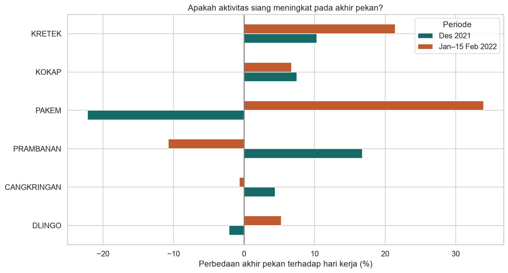
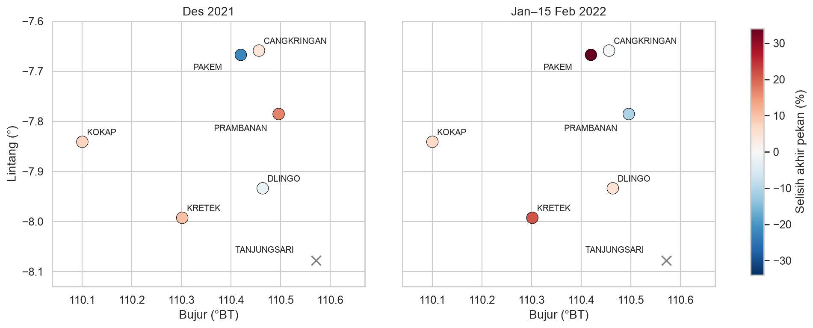

# Apakah Kawasan Wisata Jogja Lebih Aktif Saat Akhir Pekan?

Versi 2.0 — Studi kasus aktivitas regional, 1 Desember 2021–15 Februari 2022.

| Anggota | NIM |
|---|---|
| Muhammad Khoirunas | 24/533373/TK/59083 |
| Aulia Nur Fajri Tri Anggoro | 24/535054/TK/59327 |
| Muhammad Farrel Alghazy | 24/540589/TK/60022 |
| Wangsit Nursyahada | 24/545092/TK/60594 |
| Naufal Dzaky | 24/543697/TK/60431 |

## Pertanyaan dan data

Apakah rata-rata presence siang hari akhir pekan lebih tinggi dibanding Senin–Jumat di wilayah yang memiliki destinasi terdokumentasi? Sumber utama adalah JogjaPulse/UGM dan kurasi referensi resmi Visiting Jogja yang terbit sebelum periode analisis. Tanggal publikasi membuktikan destinasi sudah terdokumentasi, bukan menjamin selalu beroperasi selama pandemi.

## Pemilihan dan pengolahan

Tujuh kasus dipilih berdasarkan dokumentasi lokasi sebelum membandingkan hasil mobilitas. Kode dan nama wilayah diperiksa terhadap sumber mobilitas. Ini studi kasus, bukan sampel acak atau inventaris lengkap. Wilayah yang tidak dipilih tidak diasumsikan tanpa wisata.

Coverage minimal 90% pada masing-masing periode. Tanjungsari/Pantai Baron tidak lolos. Enam kasus juga memenuhi minimal empat hari akhir pekan dan sepuluh hari kerja lengkap pada masing-masing periode. Semua 10 jam 08–17 harus terbit pada hari yang dipakai. Nilai hilang tidak diisi nol.

Kehadiran siang = rata-rata hitungan perangkat per jam 08–17, bukan jumlah perangkat unik harian. Perbedaan akhir pekan = 100 × (rerata akhir pekan / rerata hari kerja − 1). Perbandingan dilakukan terpisah Desember dan Januari–15 Februari karena perubahan sampel. Tidak membandingkan volume absolut antarperiode.

## Hasil

| Wilayah | Desember (%) | Januari–15 Februari (%) |
|---|---:|---:|
| CANGKRINGAN | 4.41 | -0.68 |
| DLINGO | -2.14 | 5.27 |
| KOKAP | 7.49 | 6.76 |
| KRETEK | 10.33 | 21.43 |
| PAKEM | -22.22 | 33.98 |
| PRAMBANAN | 16.79 | -10.73 |

Kokap dan Kretek memiliki perbedaan positif pada dua periode. Empat kasus lainnya berubah arah. Jawaban untuk keseluruhan kasus tidak seragam; hasil tidak mendukung klaim bahwa setiap kawasan wisata selalu lebih aktif saat akhir pekan. Angka adalah deskriptif, tanpa klaim signifikansi statistik.

## Sensitivitas dan keterbatasan

Analisis juga diulang tanpa 25 Desember, 1 Januari, dan 1 Februari. Tabel `sensitivity_dates.csv` dan grafik terkait memperlihatkan perubahan. Ini tidak mengendalikan seluruh kalender libur, event, pandemi, atau tren dalam periode. Penutupan destinasi dan perubahan aplikasi tetap dapat memengaruhi hasil.

Presence adalah seluruh perangkat teramati pada kapanewon, termasuk penduduk dan aktivitas lain. Bukan data tiket, identitas wisatawan, perjalanan, atau jumlah pengunjung destinasi. Perbedaan tidak membuktikan sebab-akibat keberadaan wisata. Peta memakai lokasi representatif administratif OpenStreetMap saat pengambilan, bukan batas historis atau koordinat pintu destinasi.

## Reproduksi dan referensi

Notebook membaca dua tab data utama dan satu tab lokasi dari Sheets publik. Perhitungan dan sepuluh grafik dijalankan ulang dari URL publik; pemeriksaan kunci, kelengkapan jam, pemetaan, dan hasil lulus. Daftar referensi per baris dapat diperiksa di `data/tourism/destinations.csv`; OpenStreetMap digunakan untuk orientasi spasial.
